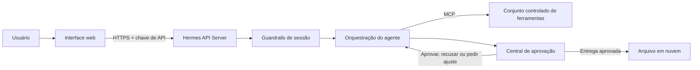

# Arquitetura com Hermes Agent, MCP e aprovação humana

Estudo de caso sanitizado de uma integração exercitada em ambiente hospedado. O objetivo foi conectar uma interface web a um agente Hermes, permitir o uso controlado de ferramentas externas e manter aprovação humana antes da entrega final.

Este é um registro independente de arquitetura. Não é um repositório oficial do Hermes Agent e não contém chaves, endereços privados, dados de clientes ou código proprietário.

## Problema

O fluxo precisava receber pedidos em linguagem natural, executar tarefas fora do navegador, devolver uma prévia para revisão e só arquivar a entrega depois de uma decisão humana. Também era necessário impedir que sessões externas acessassem terminal, arquivos ou memória sem autorização.

## Arquitetura exercitada

## Componentes

- Hermes Agent executando continuamente em uma VPS Linux.
- API Server exposto por HTTPS por meio de túnel dedicado.
- Autenticação por chave fora do código-fonte.
- Integração MCP com 21 ferramentas descobertas pelo cliente.
- Plugin de guardrail em modo fail-closed para restringir ferramentas em sessões externas.
- Central de aprovação com estados de revisão e registro das decisões.
- Arquivamento em nuvem somente após aprovação.

## Fluxo

1. O usuário envia um pedido pela interface web.
2. A interface chama o endpoint compatível com OpenAI do Hermes.
3. O guardrail identifica a sessão e reduz o conjunto de ferramentas permitido.
4. O agente usa MCP para consultar ou alterar apenas os recursos autorizados.
5. A saída é enviada para a central de aprovação.
6. O usuário aprova, recusa ou solicita ajuste.
7. Uma entrega aprovada é arquivada e o agente devolve o link correspondente.

## Verificações realizadas

- Requisição ao endpoint sem chave retornou HTTP 401.
- Consulta autenticada de capacidades retornou HTTP 200.
- O cliente descobriu 21 ferramentas MCP.
- Um teste ponta a ponta percorreu interface, API Server, agente, chamada MCP e resposta.
- Uma sessão restrita tentou usar terminal e foi bloqueada pelo guardrail.
- A decisão de revisão foi persistida e usada pelo fluxo posterior.
- O upload do material aprovado para o armazenamento em nuvem foi confirmado por leitura dos arquivos criados.

## Decisões de segurança

- Segredos ficam em variáveis de ambiente e não em arquivos versionados.
- O endpoint público exige autenticação inclusive nas rotas de diagnóstico expostas.
- Sessões externas recebem identidade própria e uma lista mínima de ferramentas.
- A política é fail-closed: se a identidade ou a regra não puder ser validada, a ferramenta não é liberada.
- Toda publicação ou arquivamento depende de aprovação humana explícita.
- Logs registram chamada, origem, estado e decisão sem copiar credenciais.

## Limites do caso

- O estudo comprova integração e controle de acesso, não escala de produção.
- A publicação final permaneceu assistida; não foi tratada como automação sem supervisão.
- Os componentes específicos do projeto original foram omitidos ou generalizados para preservar dados privados.

## Competências demonstradas

Hermes Agent · agentes de IA · Model Context Protocol (MCP) · integração de APIs · guardrails · human-in-the-loop · HTTPS · Cloudflare Tunnel · Linux · serviços persistentes · automação · documentação de arquitetura
